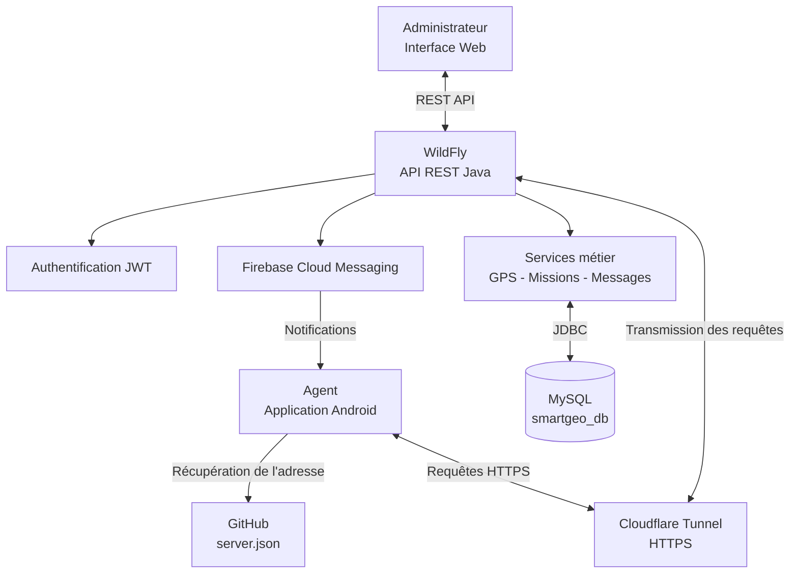
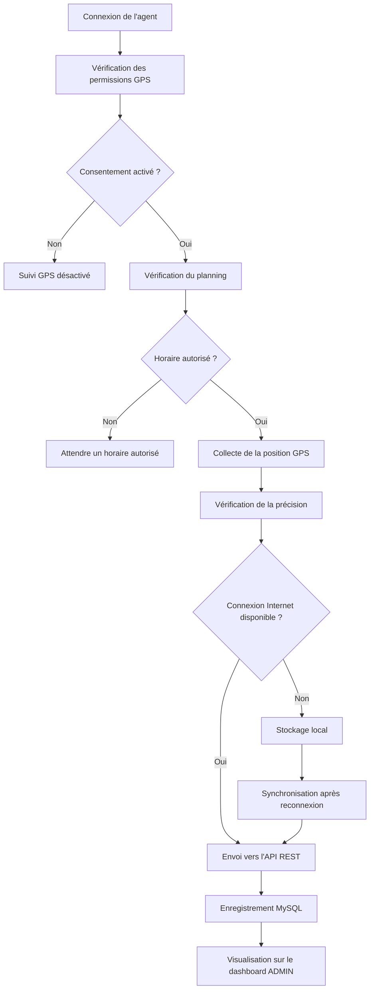
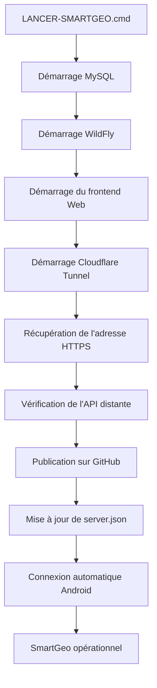

# 📍 SmartGeo — Smart Geolocation & Monitoring System


## 📖 Présentation du projet

SmartGeo est une solution de géolocalisation, de suivi GPS et de supervision des agents, développée dans le cadre d'un projet universitaire.

Le système repose sur une architecture client-serveur composée d'une application mobile Android, d'une API REST développée en Java, d'une interface d'administration Web et d'une base de données MySQL.

SmartGeo permet aux administrateurs de superviser les déplacements des agents, de consulter leurs positions géographiques, de gérer les plannings GPS et de communiquer avec les utilisateurs.

L'application prend également en charge un mécanisme de synchronisation hors ligne et une configuration dynamique de l'adresse du serveur distant.

---

## 🎯 Objectifs du projet

- Collecter les positions GPS des utilisateurs.
- Visualiser les déplacements sur une carte interactive.
- Superviser plusieurs utilisateurs simultanément.
- Gérer les autorisations et les horaires de suivi GPS.
- Respecter le consentement des utilisateurs.
- Faciliter la communication entre les agents et les administrateurs.
- Conserver un historique des déplacements.
- Assurer une synchronisation des données après une interruption réseau.
- Automatiser le démarrage des différents services.
- Permettre l'accès distant depuis plusieurs téléphones Android.

---

## 👥 Types d'utilisateurs

### Administrateur — ADMIN

L'administrateur dispose d'une interface Web permettant de :

- Gérer les comptes utilisateurs.
- Créer, modifier et consulter les plannings GPS.
- Visualiser les positions des agents.
- Consulter les historiques de déplacement.
- Afficher les trajets sur une carte interactive.
- Superviser plusieurs utilisateurs.
- Gérer les missions.
- Consulter les signalements.
- Communiquer avec les agents.
- Consulter les informations de supervision.

### Agent — USER

L'agent utilise l'application mobile Android pour :

- Se connecter à son espace personnel.
- Consulter et modifier son profil.
- Autoriser ou désactiver le suivi GPS.
- Consulter ses horaires de suivi.
- Transmettre ses positions géographiques.
- Activer le suivi automatique.
- Consulter ses missions.
- Envoyer et recevoir des messages.
- Recevoir des notifications.
- Envoyer des signalements.
- Consulter son historique GPS.

---

## ⚙️ Fonctionnalités principales

| Fonctionnalité | Description |
|---|---|
| Authentification | Connexion avec gestion des sessions JWT |
| Gestion des rôles | Séparation des espaces ADMIN et USER |
| Géolocalisation | Collecte des positions GPS réelles |
| Suivi automatique | Transmission périodique des positions |
| Cartographie | Visualisation des agents et de leurs trajets |
| Historique GPS | Consultation des positions enregistrées |
| Planification | Définition des horaires autorisés de suivi |
| Consentement | Contrôle utilisateur du suivi GPS |
| Mode hors ligne | Conservation locale des positions en attente |
| Synchronisation | Transmission des positions après reconnexion |
| Missions | Gestion et consultation des missions |
| Messagerie | Communication entre administrateurs et agents |
| Notifications | Notifications via Firebase Cloud Messaging |
| Signalements | Transmission des incidents et informations |
| Configuration dynamique | Récupération automatique de l'adresse API |
| Déploiement automatisé | Démarrage des services en un seul clic |

---

## 🛠️ Technologies utilisées

### Application Android

- Kotlin
- XML Layouts
- Android SDK
- Android Studio
- Google Play Services Location
- Kotlin Coroutines
- WorkManager
- SQLite
- Firebase Cloud Messaging
- REST API
- JSON

### Backend

- Java
- Jakarta EE
- JAX-RS
- Maven
- WildFly Application Server
- JDBC
- JWT Authentication
- RESTful Web Services

### Frontend Web

- HTML5
- CSS3
- JavaScript
- Leaflet
- OpenStreetMap
- Fetch API

### Base de données

- MySQL
- MySQL Workbench
- SQL

### Infrastructure et déploiement

- Cloudflare Quick Tunnel
- GitHub
- PowerShell
- Windows Batch Scripts
- HTTPS

---

## 🏗️ Architecture générale



L'application Android communique avec le backend Java via des requêtes HTTP sécurisées par HTTPS à travers Cloudflare Tunnel.

Le backend assure le traitement des requêtes, l'authentification, la gestion des règles métier et la communication avec MySQL.

L'interface Web permet aux administrateurs de superviser les utilisateurs et leurs activités.

---

## 📂 Structure du dépôt

```text
Smartgeo/
│
├── SmartGeoBackend/
│   ├── src/
│   │   └── main/
│   │       ├── java/
│   │       ├── resources/
│   │       └── webapp/
│   └── pom.xml
│
├── SmartGeo2/
│   ├── app/
│   │   └── src/
│   │       └── main/
│   │           ├── java/
│   │           ├── res/
│   │           └── AndroidManifest.xml
│   ├── gradle/
│   ├── build.gradle.kts
│   ├── settings.gradle.kts
│   ├── gradle.properties
│   ├── gradlew
│   └── gradlew.bat
│
├── SmartGeoFrontend/
│   ├── HTML
│   ├── CSS
│   └── JavaScript
│
├── server.json
├── .gitignore
└── README.md
```

---

## 🗄️ Base de données

Le projet utilise une base de données MySQL nommée :

```sql
smartgeo_db
```

Elle permet de centraliser les informations relatives aux :

- Utilisateurs.
- Positions géographiques.
- Plannings GPS.
- Consentements.
- Missions.
- Messages.
- Signalements.
- Notifications.

Les communications entre le backend et MySQL sont réalisées à l'aide de JDBC.

Les identifiants de connexion à la base de données ne sont pas publiés dans ce dépôt.

---

## 🌍 Fonctionnement du suivi GPS



Les positions GPS sont collectées uniquement lorsque les conditions nécessaires de permission, de consentement et de planification sont respectées.

En cas d'interruption de connexion, les positions éligibles peuvent être conservées localement pour une synchronisation ultérieure.

---

## ☁️ Configuration dynamique du serveur

SmartGeo utilise Cloudflare Quick Tunnel pour rendre le backend accessible depuis Internet.

Comme l'adresse Cloudflare peut changer après un redémarrage, le projet utilise GitHub comme point de configuration permanent.

Le fichier suivant contient l'adresse actuelle du serveur :

[server.json](https://raw.githubusercontent.com/oa6-boop/Smartgeo/main/server.json)

Exemple de configuration :

```json
{
  "apiUrl": "https://example.trycloudflare.com/smartgeo/api",
  "updatedAt": "2026-11-26T12:00:00Z"
}
```

L'adresse présentée ci-dessus est uniquement un exemple.

L'application Android récupère automatiquement l'adresse active avant de communiquer avec le backend.

Ce mécanisme permet de conserver le même APK lorsque l'adresse du tunnel change.

---

## 🚀 Démarrage automatique

L'environnement local SmartGeo dispose d'un système de lancement automatisé basé sur PowerShell et Windows Batch.



Le lancement complet est réalisé depuis le fichier local :

```text
LANCER-SMARTGEO.cmd
```

Ce lanceur permet de :

1. Démarrer MySQL.
2. Démarrer WildFly.
3. Démarrer le frontend Web.
4. Démarrer Cloudflare Tunnel.
5. Vérifier l'accessibilité du backend.
6. Publier la nouvelle adresse sur GitHub.
7. Permettre aux téléphones de retrouver automatiquement le serveur.

Les scripts de déploiement et leurs configurations locales doivent être installés séparément s'ils ne sont pas inclus dans le dépôt.

---

## 📥 Installation du projet

### 1. Cloner le dépôt

```bash
git clone https://github.com/oa6-boop/Smartgeo.git

cd Smartgeo
```

### 2. Prérequis

- Java JDK compatible avec le projet.
- Apache Maven.
- WildFly Application Server.
- MySQL Server.
- Android Studio.
- Android SDK.
- Git.
- Cloudflared.
- Windows PowerShell.

### 3. Compiler le backend

```bash
cd SmartGeoBackend

mvn clean package
```

Le fichier WAR généré se trouve dans le dossier :

```text
target/smartgeo.war
```

Déployer ce fichier dans le répertoire `standalone/deployments` de WildFly après avoir configuré la base de données et les secrets nécessaires.

### 4. Compiler Android

Depuis le dossier Android :

```bash
cd SmartGeo2
```

Sous Windows :

```bash
./gradlew.bat clean assembleDebug
```

Sous Linux :

```bash
./gradlew clean assembleDebug
```

Les fichiers de configuration locaux, notamment Firebase, doivent être restaurés avant la compilation.

L'APK généré se trouve dans :

```text
app/build/outputs/apk/debug/app-debug.apk
```

### 5. Installer l'application

Transférer l'APK sur un téléphone Android compatible.

Installer l'application, puis autoriser les permissions nécessaires pour la localisation et les notifications.

---

## 🔗 Adresses principales

| Service | Adresse |
|---|---|
| WildFly | http://localhost:8080 |
| API REST locale | http://localhost:8080/smartgeo/api |
| Dashboard ADMIN | http://localhost:5500/dashboard-admin.html |
| Vérification API | http://localhost:8080/smartgeo/api/health |
| Vérification MySQL | http://localhost:8080/smartgeo/api/health/database |
| Configuration distante | [server.json](https://raw.githubusercontent.com/oa6-boop/Smartgeo/main/server.json) |

Les adresses localhost sont accessibles depuis la machine hébergeant le serveur.

L'application Android utilise l'adresse HTTPS dynamique publiée dans `server.json`.

---

## 🔐 Sécurité et confidentialité

Le projet intègre plusieurs mécanismes de protection :

- Authentification JWT.
- Gestion des rôles ADMIN et USER.
- Vérification des permissions.
- Consentement utilisateur pour le suivi GPS.
- Contrôle des horaires autorisés.
- Communications distantes via HTTPS.
- Protection locale des positions GPS en attente.
- Stockage local chiffré du jeton GitHub de publication.
- Exclusion des identifiants et clés privées du dépôt.

Les mots de passe, jetons privés, clés de service et données personnelles ne doivent jamais être publiés sur GitHub.

Le suivi GPS doit être effectué avec le consentement des utilisateurs concernés.

---

## 🧪 Tests fonctionnels

Les tests réalisés ou à compléter concernent :

- Authentification des utilisateurs.
- Gestion des rôles.
- Connexion à MySQL.
- Communication Android et backend Java.
- Géolocalisation sur téléphone physique.
- Transmission des positions GPS.
- Consultation des données depuis le dashboard.
- Connexion depuis un réseau mobile.
- Déploiement automatique des services.
- Publication automatique sur GitHub.
- Récupération dynamique de l'adresse Cloudflare.
- Reconnexion après redémarrage du tunnel.
- Synchronisation après interruption réseau.
- Messagerie et notifications.
- Gestion des missions et signalements.

---

## ⚠️ Limites actuelles

SmartGeo est actuellement destiné à un environnement universitaire et de démonstration.

- Le serveur nécessite un ordinateur allumé et connecté à Internet.
- Cloudflare Quick Tunnel utilise des adresses temporaires.
- Le service Quick Tunnel ne garantit pas une disponibilité permanente.
- Le jeton GitHub doit être renouvelé avant son expiration.
- La précision GPS dépend du téléphone et des conditions environnementales.
- Certaines fonctionnalités dépendent des permissions Android.

Pour un déploiement en production, un hébergement permanent, un domaine stable et une validation approfondie de la sécurité sont recommandés.

---

## 🔮 Perspectives d'amélioration

- Hébergement permanent du backend.
- Optimisation de la consommation énergétique GPS.
- Amélioration des mécanismes de synchronisation.
- Analyse statistique des déplacements.
- Exportation des rapports PDF et Excel.
- Gestion des zones géographiques avec Geofencing.
- Détection automatique des entrées et sorties de zones.
- Notifications intelligentes.
- Amélioration de la supervision en temps réel.
- Déploiement CI/CD avec GitHub Actions.

---

## 🎓 Contexte académique

SmartGeo est un projet universitaire réalisé dans le cadre
de l'apprentissage du développement mobile, des architectures
client-serveur et des systèmes d'information géographiques.

Il met en pratique plusieurs domaines informatiques :

- Développement Android.
- Programmation Java.
- Architecture REST.
- Gestion de bases de données.
- Géolocalisation.
- Réseaux informatiques.
- Authentification et sécurité.
- Automatisation du déploiement.
- Intégration de services Cloud.

---

## 👨‍💻 Développement

**Projet :** SmartGeo

**Catégorie :** Application mobile et système de supervision GPS

**GitHub :** [oa6-boop](https://github.com/oa6-boop)

**Année universitaire :** 2026–2027

---

## 📄 Licence

Projet par Ahmed Ouaadidy & Taha Slaoui.

---

<div align="center">

### SmartGeo

**Locate • Monitor • Manage**

Smart Geolocation & Intelligent Monitoring System

</div>
